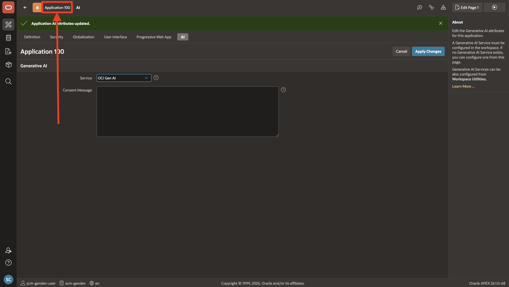
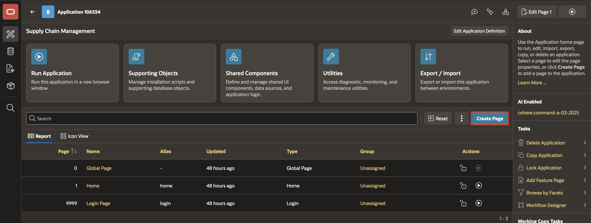
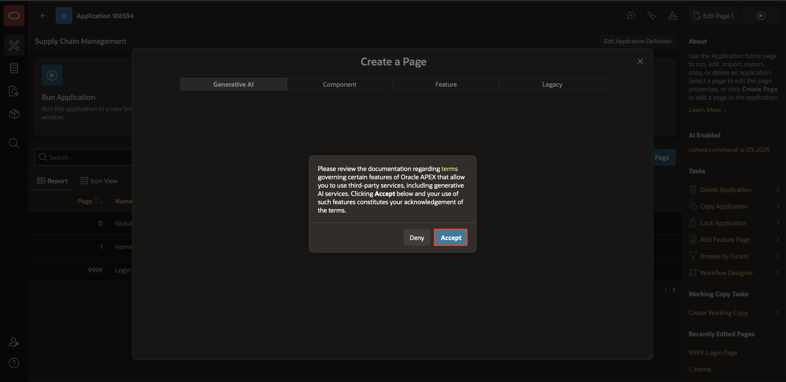
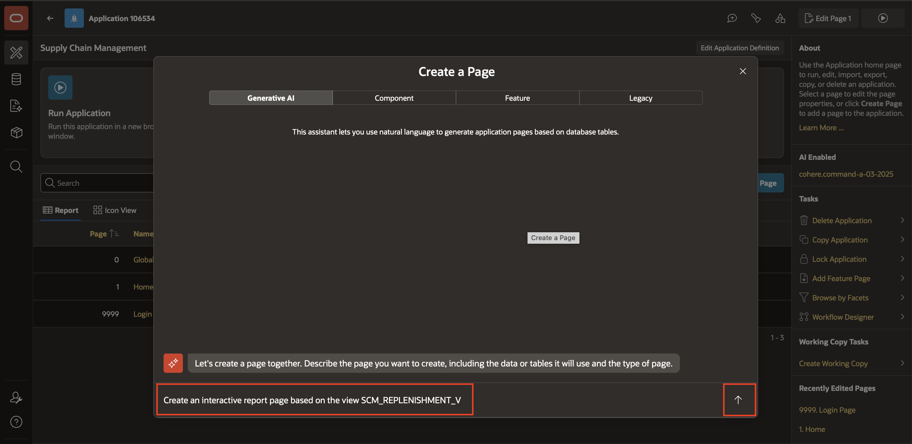
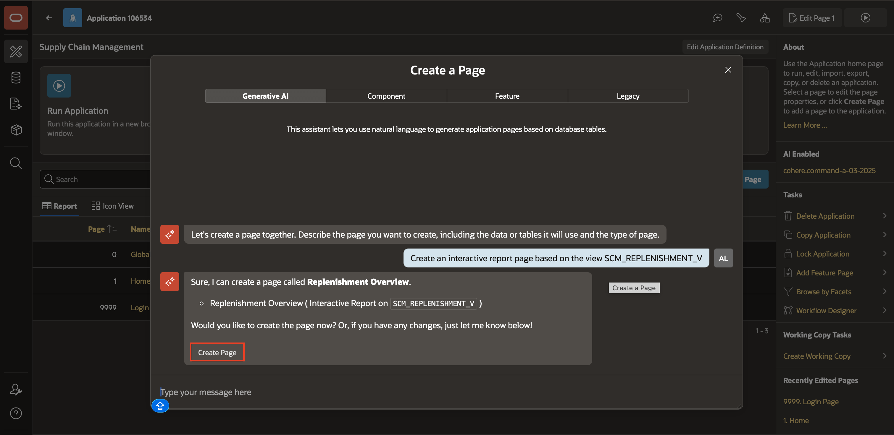
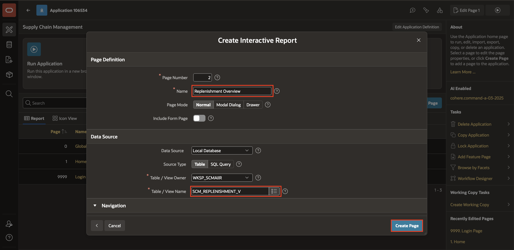
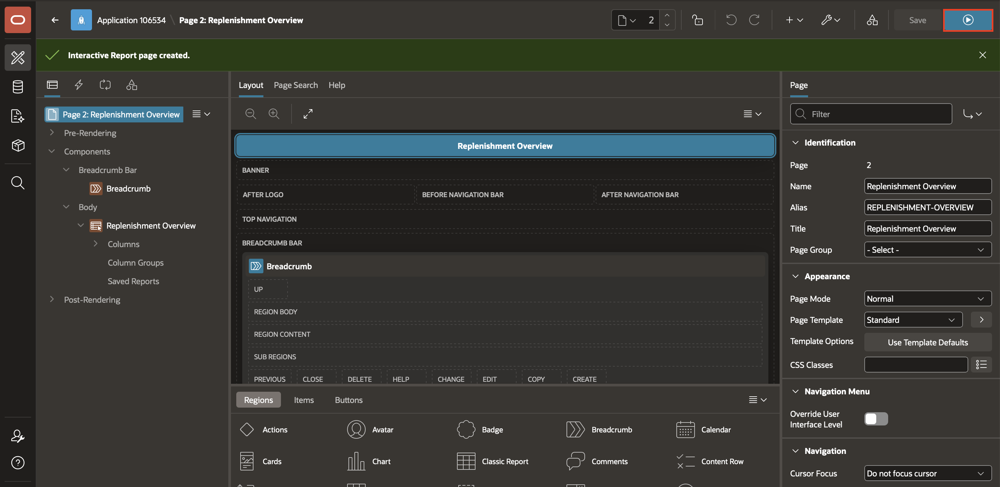
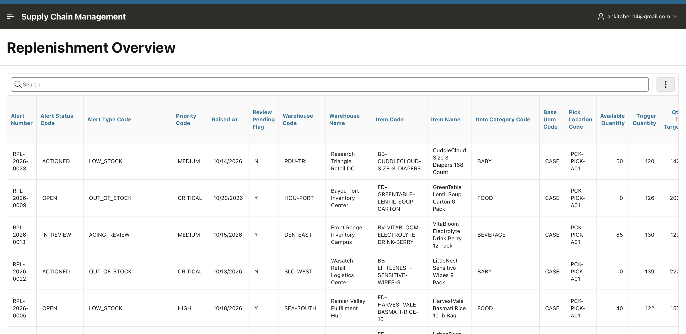

# Create an Interactive Report Using Natural Language

## Introduction

This lab creates the core replenishment report used throughout the rest of the workshop. With `SCM_REPLENISHMENT_V` already created by the data model script, you will use the natural-language page creation wizard to build an Interactive Report based on that view. Report-level Natural Language Support and context are configured in Lab 5 before you use AI search.

Estimated Lab Time: 5 minutes

### Objectives

In this lab, you learn how to:

- Create an Interactive Report page using natural language.

## Task 1: Build an Interactive Report page from a view

Oracle APEX can generate an Interactive Report page from a natural language description, selecting the appropriate source object and configuring the region automatically. Instead of navigating through menus and dialogs, you describe the page you need and APEX builds it for you. In this task, you will use that capability to create a replenishment report page based on **SCM\_REPLENISHMENT\_V**, the view created by the data model script in Lab 1.

1. Select **Application &lt;APP\_ID&gt;** in the breadcrumb to return to the Application home page.

    

2. From the Application home page, select **Create Page**.

    

3. If the APEX Assistant asks for consent the first time you use Generative AI in the development environment, select **Accept**.

    

4. Use natural language to request a new Interactive Report page based on the view **SCM\_REPLENISHMENT\_V**. For example, enter:

    ```
    <copy>
    Create an interactive report page based on the view SCM_REPLENISHMENT_V
    </copy>
    ```

    

5. Review the generated page, then select **Create Page**.

    

6. Review the suggested page details, change **Page Name** to **SCM Replenishment**, confirm that **Table / View Name** is **SCM\_REPLENISHMENT\_V**, then select **Create Page**.

    

7. Select **Run**.

    

    Confirm that the report renders from the view.

    

## Summary

You created the SCM Replenishment Interactive Report from `SCM_REPLENISHMENT_V`. In the next lab, you will explore the APEX 26.2 report layout and its standard controls. Complete Lab 5 before returning to Lab 4 Task 2 to try its key phrases, since Search with AI is enabled in Lab 5 Task 1.

You may now **proceed to the next lab**.

## Acknowledgements

- **Author** - Ankita Beri, Senior Product Manager
- **Last Updated By/Date** - Ankita Beri, Senior Product Manager, October 2026
