# Use the Interactive Report Chat Assistant

## Introduction

The right-side chat panel labeled **Assistant** provides a conversational experience focused exclusively on report configuration. It performs AI-driven interpretation only - the dialog explains which settings were applied and supports incremental refinement through follow-up prompts. Only the Interactive Report displays the data; the Assistant does not display business data, analytics, or summaries. It applies configuration by setting Interactive Report chips.

In this lab, you will use the Assistant to organize replenishment alerts by warehouse, highlight low-stock rows, calculate a **Stock Shortfall** column, chart alert volume by alert type, and save the finished view as **Alert Type Summary**. Instead of navigating menus and dialogs, you will ask the Assistant to apply these report settings through conversational prompts.

Estimated Lab Time: 7 minutes

### Objectives

In this lab, you learn how to:

- Organize the report by warehouse with alert counts, highlight low-stock items, and calculate stock shortfall.
- Chart alert volume by alert type and save the finished view for reuse.

## Task 1: Build and Save an Alert Summary Report

Like Search with AI in the search bar, the Assistant can use natural language to configure Interactive Reports. In this task, you will use the conversational panel to create a warehouse breakdown with alert counts, highlight low-stock rows, calculate the difference between trigger and available quantities, create a chart by alert type, and save the report view.

1. Select **Reset** to clear report settings left from the previous task.

    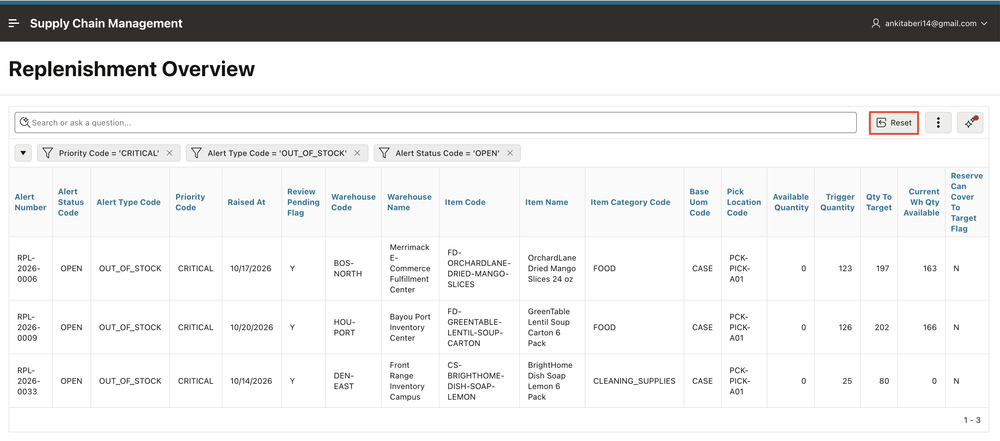

2. In the confirmation dialog, select **Apply** to restore the default report settings.

    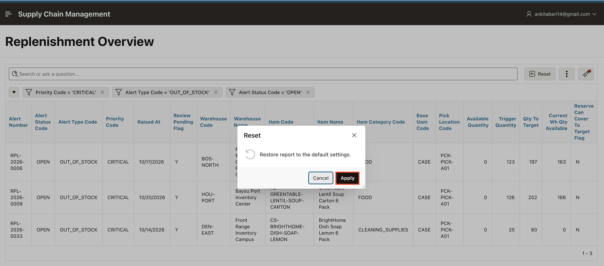

3. Select **Assistant** to open the right-side chat panel for the Interactive Report.

    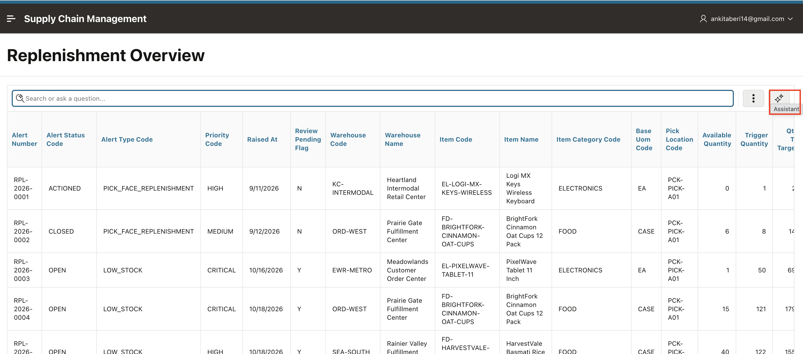

4. Enter the following and send the prompt. Confirm that the report shows a section for each warehouse and a count of alerts in each section.

    ```
    <copy>
    Break the report by warehouse and count the alerts for each
    </copy>
    ```

    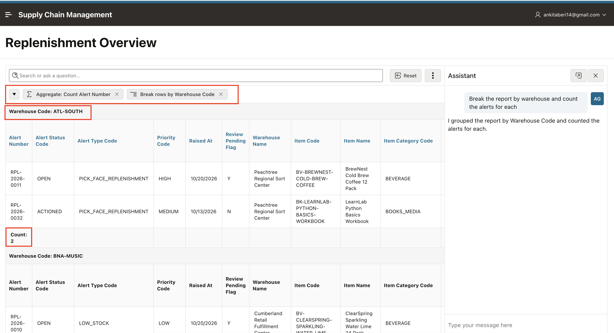

5. Without resetting, enter the following and send the prompt.

    ```
    <copy>
    Highlight items where current warehouse stock is below 10 units
    </copy>
    ```

    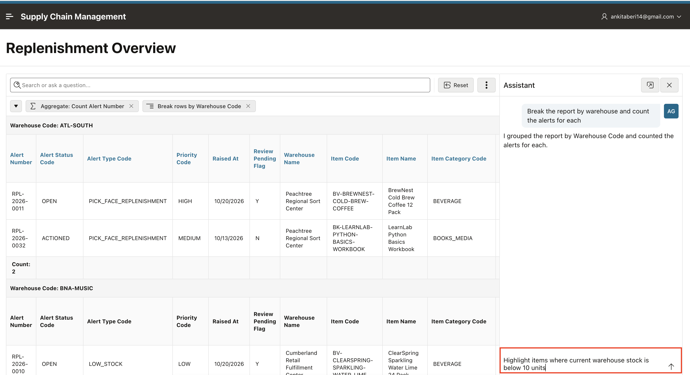

6. Confirm that the highlight rule is applied. Rows where current warehouse stock is below 10 units now stand out in color.

    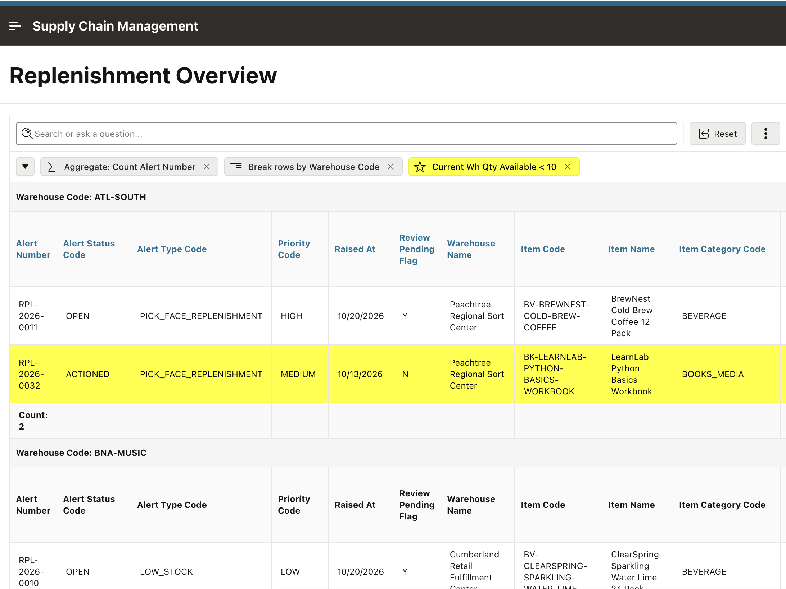

7. Without resetting the report, enter the following prompt and send it to calculate the difference between the trigger quantity and the available quantity for each alert.

    ```
    <copy>
    Create a computed column called Stock Shortfall that subtracts Available Quantity from Trigger Quantity for each alert.
    </copy>
    ```

    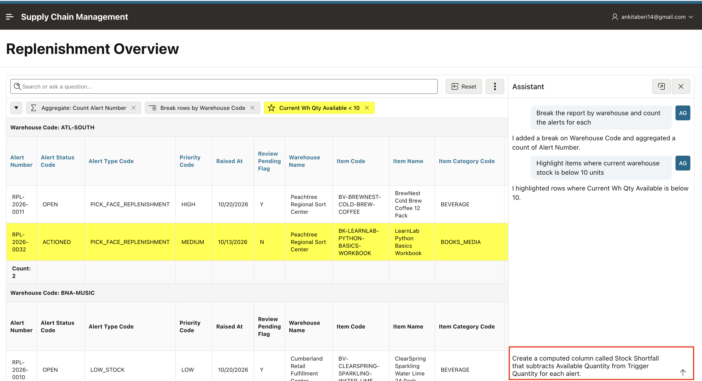

8. Confirm that **Stock Shortfall** appears as a computed column and shows the result of **Trigger Quantity - Available Quantity** for each alert.

    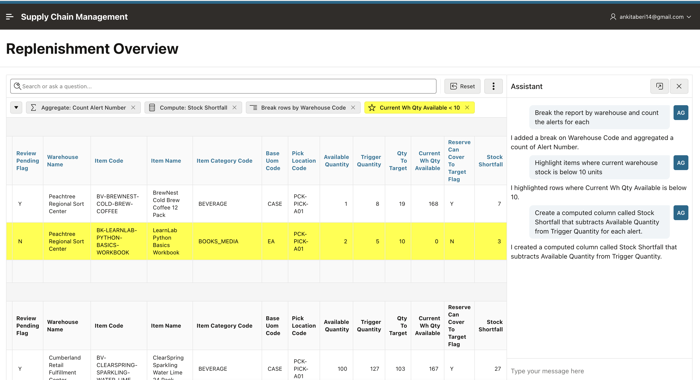

9. Enter `Reset` in the Assistant and send the prompt. Confirm that the report returns to its default view.

    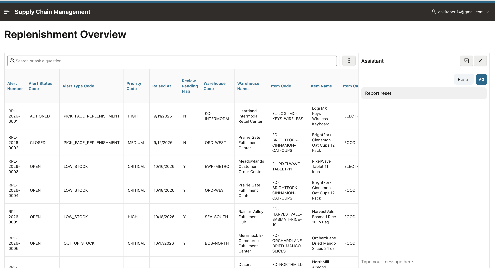

10. Enter the following and send the prompt to create a chart of alert volume by alert type.

    ```
    <copy>
    Show a bar chart of the number of alerts by Alert Type Code
    </copy>
    ```

    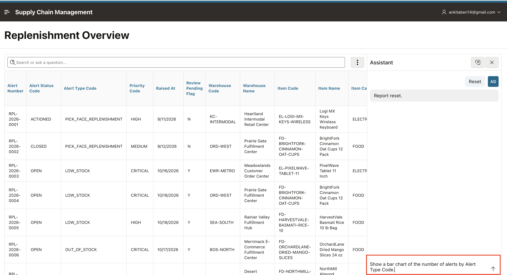

11. Confirm that the report switches to a bar chart with alert type on the x-axis and the alert count on the y-axis.

    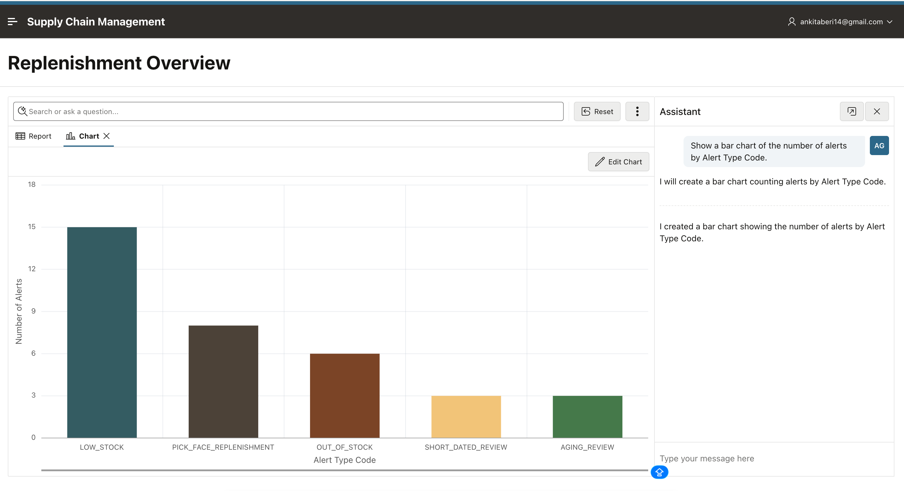

12. Enter the following and send the prompt.

    ```
    <copy>
    Save this report as Alert Type Summary
    </copy>
    ```

    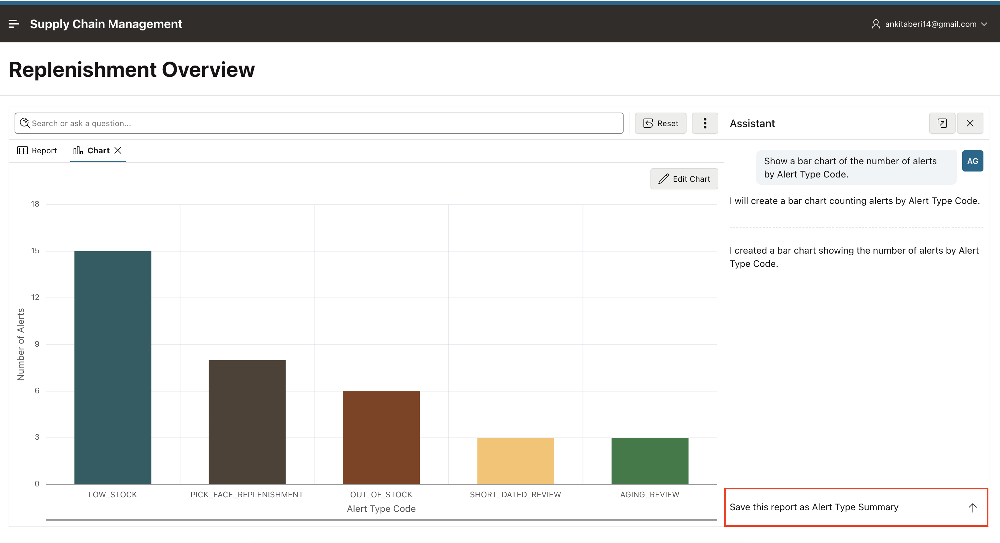

13. Confirm that **Alert Type Summary** appears in the available report views. The team can now reopen this view without reconfiguring the report.

    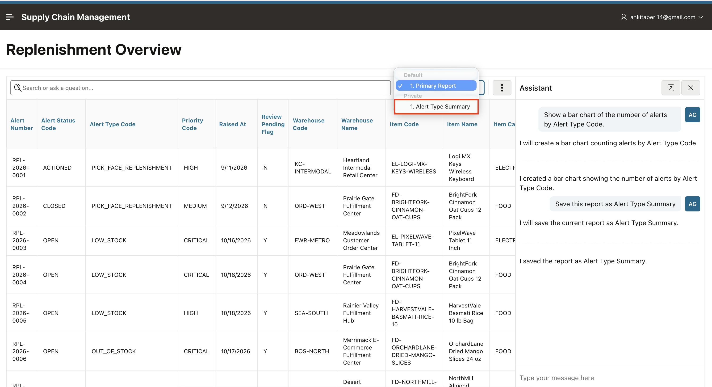

## Summary

You used the Interactive Report Chat Assistant to group alerts by warehouse, count alerts, highlight low-stock rows, calculate **Stock Shortfall** for each alert, chart alert counts by type, and save the result as **Alert Type Summary**.

You may now **proceed to the next lab**.

## Acknowledgements

- **Author** - Ankita Beri, Senior Product Manager
- **Last Updated By/Date** - Ankita Beri, Senior Product Manager, October 2026
